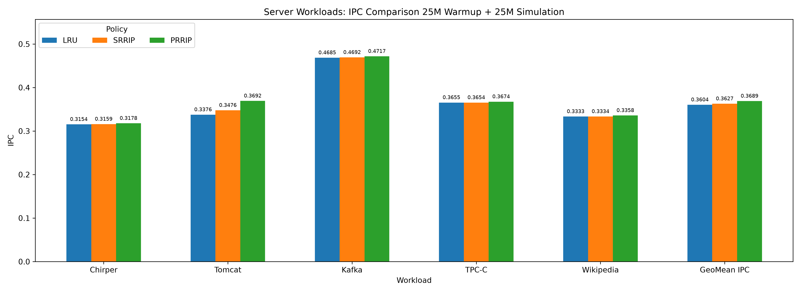
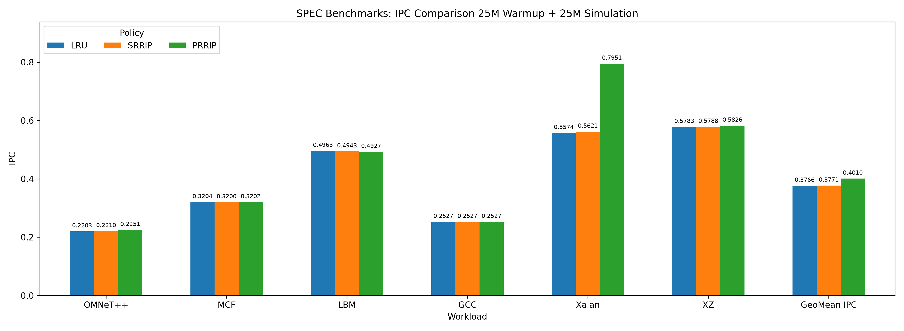

<h1 align="center">PHASE AWARE UNIFIED L2 CACHE REPLACEMENT</h1>

<p align="center">
  <strong>Parthsinh R. Thakor</strong><br>
  Department of Computer Science and Engineering<br>
  IIT Bombay<br>
  parthsinh@cse.iitb.ac.in
</p>

## Overview

A unified L2 cache stores Instruction, Data and PTE blocks. Their reuse behaviour can change during execution, so keeping one fixed class priority may help in some parts of a workload and hurt in others.

This project uses ChampSim to study these classes and develop PRRIP. Checkpoint I used upstream pressure signals to decide class priority. In Checkpoint II, I used the history of evicted blocks as reuse feedback and added set dueling to select the insertion policy.

## Checkpoint I

- [x] Identify Instruction, Data and PTE blocks using an enum class field.
- [x] Collect baseline class-wise accesses, hits and misses.
- [x] Test all six fixed priority orders: IDP, IPD, DIP, DPI, PID and PDI.
- [x] Analyze phase-wise IPC and possible feedback signals, including L1I, L1D and STLB MPKI.
- [x] Implement the initial pressure-based, 3-bit RRIP policy.

Here, I means Instruction, D means Data and P means PTE. The first class in an order gets the highest priority.

The initial policy improved IPC on some workloads. Longer runs showed a problem in MCF and TPC-C, where losses against LRU increased from 25M to 75M simulation instructions. Adding set dueling to that version did not resolve these losses.

## Checkpoint II

- [x] Test the initial policy on longer runs and try set dueling.
- [x] Keep separate history tables for evicted Instruction, Data and PTE blocks.
- [x] Use class reuse feedback for insertion and victim selection with 2-bit RRIP.
- [x] Add set dueling between reuse-based insertion and BRRIP insertion.
- [x] Evaluate 11 workloads against LRU and SRRIP with 25M warmup and 25M simulation instructions.
- [x] Test history-table size and other policy settings, and compare L2 cache counters.

## Reuse-Based PRRIP

In PA2, the stride prefetcher used a table to remember past accesses and find repeating patterns. I considered using a similar table to remember evicted blocks and check whether they come back. The final policy code is in [replacement/prrip.l2c.cc](replacement/prrip.l2c.cc).

### History table

Each class has 256 entries. Each entry has the evicted address and its valid bit, while a separate circular index keeps track of where to save the next block for that class. A circular index selects the next location, so new entries overwrite old slots in FIFO order.

On a non-writeback L2 miss, the incoming address is checked in its own class history. Every lookup increases the lookup counter. A match increases the history-hit counter and invalidates that entry, so the same eviction is counted once.

### Reuse feedback

Class reuse rate is `history hits / history lookups`. Minimum lookups: 16.

The policy checks the retired-instruction count on L2 replacement updates and refreshes the rates after at least 1,000 more CPU instructions have retired. The window sets the refresh interval.

### Insertion and hits

For sets using reuse-based insertion:

| Condition | RRPV |
| --- | ---: |
| Incoming address hits in history | 0 |
| History miss, class has the highest positive reuse rate and enough lookups | 1 |
| Other history miss | 2 |

Tied classes get equal treatment. Normal cache hits set RRPV to 0. Writeback hits and fills set RRPV to 2, skip the incoming history lookup and do not update PSEL. A valid block evicted by a writeback fill is still saved in history.

BRRIP insertion uses RRPV 3, with one insertion at RRPV 2 every 32 BRRIP insertions.

### Set dueling

For the current 1,024-set L2, there are 128 BRRIP leader sets, 128 reuse-policy leader sets and 768 follower sets.

PSEL starts at 511 and stays within 0 to 1,023. A BRRIP leader miss decreases it, while a reuse-policy leader miss increases it. Followers use BRRIP insertion when PSEL is at least 511 and reuse-based insertion otherwise.

History feedback is collected from all sets.

### Eviction

Among blocks at RRPV 3, prefer the class with the lowest reuse rate. If any candidate class has fewer than 16 lookups, choose the first RRPV 3 block. Equal rates also keep the first candidate.

If no block has RRPV 3, increase all RRPVs and check again. This eviction rule is shared by both types of leader sets and the followers. Set dueling selects insertion.

## Evaluation

The final comparison uses one core, a 1 MiB L2 with 1,024 sets, 16 ways and 64-byte blocks. All prefetchers are disabled. Each run uses 25M warmup instructions followed by 25M simulation instructions.

| Group | Workloads |
| --- | --- |
| Server workloads | Chirper, Tomcat, Kafka, TPC-C, Wikipedia |
| SPEC CPU2017 | OMNeT++, MCF, LBM, GCC, Xalan, XZ |

The IPC readings and calculations are in [notebooks/prrip_results.ipynb](notebooks/prrip_results.ipynb). The logs supply the IPC values.

| Geometric-mean IPC gain | Over LRU | Over SRRIP |
| --- | ---: | ---: |
| Server workloads | 2.36% | 1.70% |
| SPEC benchmarks | 6.47% | 6.35% |
| All 11 workloads | 4.59% | 4.21% |

For each workload, divide PRRIP IPC by baseline IPC, then take the geometric mean of those ratios and subtract 1. Multiply by 100 for percentage gain. In the graphs, the GeoMean IPC bars show the geometric mean of the IPC values for each policy.





### Findings

Xalan shows the largest gain. Its L2 LOAD hit rate rises from 0.03% with LRU and 0.37% with SRRIP to 36.73% with PRRIP. IPC improves by 42.65% over LRU.

L2 writeback misses increase across all 11 workloads.

Total L2 hit rate alone does not explain every result. OMNeT++ has fewer L2 hits with PRRIP, but its IPC improves by 2.17% over LRU.

## Requirements and Run

Use Ubuntu 18.04 with GCC/G++ 7.5, GNU Make, Bash, and the decompression tools for `.gz` and `.xz` traces. The analysis notebooks use pandas, Matplotlib and Seaborn. If the simulator requirements are unavailable locally, use Docker with the required environment.

Place traces in `traces/`. Edit the settings at the top of `build_champsim.sh`:

```bash
L2C_REPLACEMENT="prrip"
BINARY_NAME="prrip"
WARMUP_INSTRUCTIONS=25000000
SIMULATION_INSTRUCTIONS=25000000
TRACE_FOLDER="traces"
TRACE_NAME="omnetpp.xz"
```

Baseline policies: `lru` and `srrip`. `L2C_REPLACEMENT` selects `replacement/<name>.l2c.cc`. `BINARY_NAME` sets the executable name. Keep comparison settings identical.

Run from the project directory:

```bash
make run
```

This copies the selected policy into the build source, prints `Building Binary...`, runs `make clean` and builds the binary. Successful build output is hidden. Build errors are shown if compilation fails. A successful build starts the simulation automatically.

To save terminal output, create the destination folder and redirect the run:

```bash
mkdir -p log/manual
make run > log/manual/omnetpp_PRRIP_25m.log 2>&1
```

## Repository Layout

| Path | Contents |
| --- | --- |
| `src/`, `inc/` | Simulator source, headers and configuration |
| `replacement/` | Replacement policies, including final PRRIP |
| `prefetcher/`, `branch/` | Prefetcher and branch-predictor files |
| `traces/` | Local traces, excluded from version control |
| `data/` | Measurement CSVs |
| `notebooks/` | Baseline, fixed-order, feedback-signal and PRRIP analysis |
| `results/` | Graphs and local analysis notes |
| `scripts/` | CSV collection script |
| `log/baselines-25m-25m/` | LRU and SRRIP logs for all 11 workloads |
| `log/prrip-final-25m-25m/` | Final PRRIP logs for all 11 workloads |
| `log/initial-c1-longer-runs/` | Initial C1 policy logs at 25M and 75M simulation instructions |
| `log/initial-c1-set-dueling/` | Initial C1 policy with set dueling |
| `log/history512-25m-25m/` | Five workloads with 512 history entries per class |
| `log/prrip-C1-test/` | Checkpoint I test logs |
| `bin/`, `obj/` | Generated binaries, objects and dependency files |

## Future Work

Tune history storage and policy parameters, investigate writeback-related losses, and improve behaviour on thrashing and streaming workloads. Further experiments should separate the contribution of insertion, eviction and set dueling while keeping the other settings fixed.

## References

- [PA2 ChampSim](https://github.com/cs683-iitb-autumn-2026/pa2), the simulator base used for this project.
- [ChampSim DRRIP implementation](https://github.com/ChampSim/ChampSim/tree/master/replacement/drrip), used as a reference for set dueling and BRRIP.
- [iTP+xPTP, ASPLOS 2025](https://github.com/dchasap/itp_asplos25_AE).
- EMISSARY, ISCA 2023.
- CLIP, HPCA 2015.
- TRRIP, MICRO 2025.
